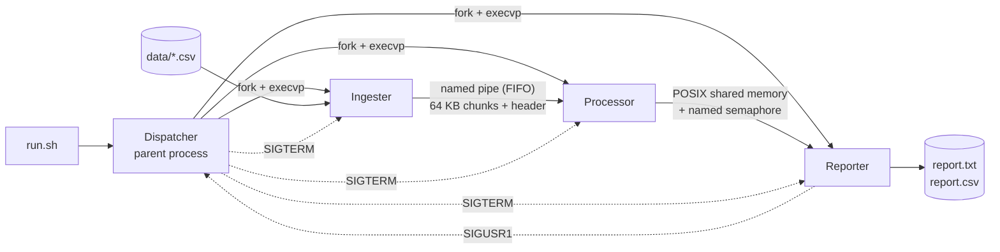

# ⚙️ Parallel IoT Sensor Log Pipeline – Linux Systems Programming in C++

A **multi-process, multi-threaded data pipeline** for Linux, built only on raw **POSIX system calls** with no frameworks. It reads IoT sensor CSV logs, processes them in parallel on a pool of worker threads, and writes a per-sensor summary with anomaly counts.

This was our group's final project for **Operating Systems** at FAST-NUCES Islamabad. The goal was to make the main OS concepts from the course (processes, IPC, threads, synchronisation and signals) work together in one realistic system.

---

## 🏗️ Architecture



| Stage | Role |
|---|---|
| **Dispatcher** | The parent process. It creates the FIFO, the shared memory and the semaphore, forks and `exec`s the three stages, sends each one's output to its own log file with `dup2`, handles signals, and removes every IPC resource on exit |
| **Ingester** | Finds the CSV files with `opendir`/`readdir` and streams them into the FIFO in 64 KB chunks. Each chunk starts with a binary header (chunk ID, file ID, byte count), and a special EOF chunk marks the end |
| **Processor** | A reader thread pulls chunks from the FIFO into a **bounded producer–consumer queue**. **N worker threads** parse the rows and update a mutex-protected aggregation table. The results go into shared memory, and the processor then signals the reporter |
| **Reporter** | Waits on the semaphore, reads the results from shared memory, sorts the sensors by average reading, and writes `report.txt` and `report.csv` |

## 🧠 OS Concepts Demonstrated

| Area | System calls / techniques |
|---|---|
| **Process management** | `fork()`, `execvp()`, `waitpid()`, exit-status reporting and per-child runtime |
| **IPC: named pipe** | `mkfifo()`, blocking `open()` for synchronisation at startup, and `read()` loops that handle partial reads |
| **IPC: shared memory** | `shm_open()`, `ftruncate()`, `mmap()`, `munmap()`, `shm_unlink()` |
| **Synchronisation** | named semaphore between processes (`sem_open`/`sem_wait`/`sem_post`); unnamed semaphores plus a mutex for the bounded queue; a second mutex for the aggregation table |
| **Threads** | `pthread_create()` with `pthread_attr_t` (joinable threads with a 2 MB stack), `pthread_join()`, and shutdown with **poison pills** |
| **Signals** | `sigaction()` handlers for `SIGCHLD`, `SIGINT`, `SIGTERM` and `SIGUSR1`, waiting with `sigsuspend()` instead of busy-looping, and handlers that only set `volatile sig_atomic_t` flags, which keeps them async-signal-safe |
| **File descriptors** | `dup2()` to send each child's output to its own log file; the reporter saves, redirects and restores stdout with `dup()`/`dup2()` |
| **Resource cleanup** | every FIFO, shared-memory segment, semaphore, mutex and heap buffer is freed, even when the pipeline is interrupted |

## 🚀 Quick Start

Requirements: Linux (or WSL), `g++`, `make`.

```bash
chmod +x run.sh
./run.sh                       # build + run with defaults (4 threads, queue size 16)
./run.sh -n 8 -q 4             # 8 worker threads, queue of 4
./run.sh -i ./data -o ./output -c   # clean rebuild first
./run.sh -h                    # all options
```

| Option | Meaning | Default |
|---|---|---|
| `-i` | Input directory of CSV files | `./data` |
| `-o` | Output directory | `./output` |
| `-n` | Worker threads (1–64) | `4` |
| `-q` | Bounded queue size (1–256) | `16` |
| `-m` | Shared memory name | `/os_proj_shm` |
| `-S` | Semaphore name | `/os_proj_ready_sem` |
| `-c` | Clean build before running | off |

The thread count and queue size are only read at runtime, so changing them doesn't need a recompile.

## 📥 Input Format

```csv
sensor_id,reading_1,reading_2,reading_3,reading_4,reading_5
SN-001,92.4,48.1,50.2,7.4,49.0
```

The first column is the sensor ID and every following column is a numeric reading. Blank lines, `#` comments and header rows are skipped. A reading counts as an **anomaly** if it is above **90** or below **10**.

## 📤 Sample Output

`output/report.txt` from the two sample files in `data/`:

```
=============================================================
  IOT SENSOR PIPELINE REPORT
  Generated by OS Final Project - IoT Variant
=============================================================

Total CSV rows processed : 60
Unique sensors found     : 8

Sensor ID                        Moving Avg  Reading Count  Anomalies
------------------------------  -----------  -------------  ---------
SN-006                                57.21             40          7
SN-002                                55.50             40          8
SN-005                                54.63             40         10
SN-001                                54.14             40         10
SN-008                                53.63             35          5
SN-004                                53.61             35          5
SN-003                                52.88             35          6
SN-007                                52.51             35          6
=============================================================
```

The same results also go to `output/report.csv`. Each stage writes its own log to `output/logs/`. These logs show PIDs, worker-thread start-up, the poison-pill shutdown and the semaphore hand-off.

To check that nothing is left behind after a run:
```bash
ls /tmp/os_proj_fifo /dev/shm/os_proj_shm /dev/shm/sem.os_proj_ready_sem
# → "No such file or directory" for all three
```

## 📁 Project Structure

```
.
├── run.sh              # Builds, validates arguments, launches the dispatcher, cleans up, prints a summary
├── Makefile            # Builds the four executables
├── src/
│   ├── dispatcher.cpp  # Parent: IPC setup, fork/exec, signals, cleanup
│   ├── ingester.cpp    # Directory scan + chunked FIFO writer
│   ├── processor.cpp   # Bounded queue + worker thread pool + aggregation
│   └── reporter.cpp    # Shared-memory reader + report writer
└── data/               # Sample sensor CSV files
```

## 🧩 Challenges We Solved

- **FIFO open deadlock:** opening a named pipe for writing blocks until something opens the read end. So the dispatcher launches the processor straight after the ingester, and the processor opens the read end early in its startup. The ingester only waits for a moment.
- **Partial pipe reads:** a single `read()` on a pipe can return less than you asked for. Chunk payloads are now read in a loop until the full byte count from the header has arrived.
- **Signal-handler safety:** `printf` and `std::cerr` inside the handlers aren't async-signal-safe and can deadlock. The handlers now only set `volatile sig_atomic_t` flags, and the logging happens in the main loop.
- **Stale IPC after a crash:** if a crash left IPC objects behind, the next run failed. Now both `run.sh` and the dispatcher remove leftover FIFOs, shared memory and semaphores.

## 👥 Team

| Member | Responsibility |
|---|---|
| **Muhammad Huzaifa** | Dispatcher: fork/exec, IPC setup, signal handling, `sigsuspend` loop, cleanup, `run.sh` |
| **Umar Jamil** | Processor: bounded queue, thread pool, CSV parsing, aggregation, shared-memory hand-off |
| **Arbaz Khan** | Ingester and Reporter: directory scan, chunked FIFO writes, `dup`/`dup2` report writing, `SIGUSR1` notification |
